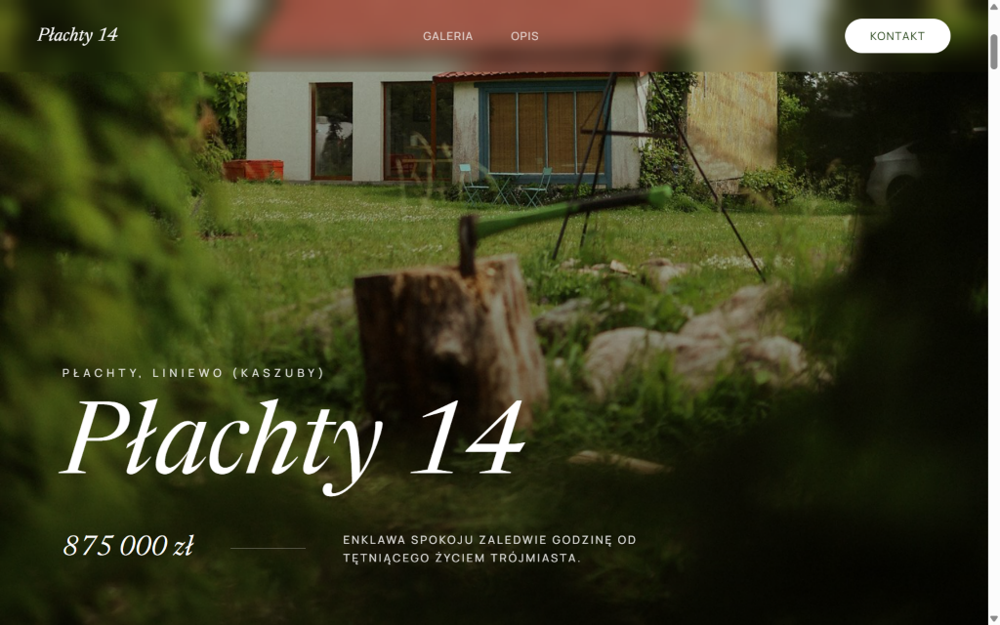

# Płachty 14

> Editorial real-estate showcase website for **Płachty 14** — a secluded 115 m² year-round homestead (*siedlisko*) on a 7,000 m² plot in Kaszuby, Poland, ~1 hour from Tricity (Trójmiasto).

**Live Website:** [plachty14.vercel.app](https://plachty14.vercel.app)



---

## Overview

This repository hosts the bespoke editorial showcase and sales landing page for **Płachty 14** (*Płachty, Liniewo — Kaszuby*). Designed with a calm, magazine-inspired visual language (*"The Curated Sanctuary"*), the site combines full-bleed property photography, drone and walkthrough videos, key investment figures, and verified guest testimonials.

---

## Website Sections & Highlights

- **Hero (`Płachty 14`)** — Full-bleed photography, location header (*Płachty, Liniewo, Kaszuby*), asking price (`875 000 zł`), and quick anchor navigation (`Galeria`, `Opis`, `Kontakt`).
- **Manifest harmonii & Opis (`#opis`)** — Editorial storytelling highlighting privacy, nature, and year-round comfort.
- **Photo & Video Gallery (`#galeria`)** — Curated property photos (`Zdjecia/`) and compressed aerial/walkthrough videos (`videos/`).
- **Esencja nieruchomości** — Key facts at a glance: `115 m²` living area, 4 rooms, `7,000 m²` secluded plot with no close neighbors, gas underfloor heating, Wi-Fi / T-Mobile antenna setup for remote work, wood-fired hot tub (*balia*), sauna, grill, and `45 000 zł` peak summer (Jul–Aug) rental performance.
- **Guest Reviews & Contact (`#kontakt`)** — Real guest impressions (`komentarzeGosci.md.txt`) and direct contact details.

---

## Tech Stack & Assets

- **Frontend:** Static HTML5 (`index.html`), local Tailwind CSS (`tailwind.js`), Google Fonts (`Newsreader`, `Manrope`), Material Symbols
- **Analytics & Hosting:** Vercel Web Analytics, deployed on Vercel
- **Design System:** Google Stitch prototypes & design tokens (`Stich/DESIGN.md`, `stitch_home.html`, `stitch_galeria.html`)
- **Media Pipeline:** Python video optimization utility (`recompress_videos.py`) for compressing DJI drone and Pixel walkthrough `.mp4` footage

---

## Local Preview

Since the site is a static HTML project, you can open `index.html` directly or serve the directory with any local HTTP server:

```bash
git clone https://github.com/mazurekbartosz1-lgtm/plachty14.git
cd plachty14
npx serve .
```

To recompress source videos in `videos/`, run:

```bash
python recompress_videos.py
```

---

## Project Structure

```text
plachty14/
├── index.html               # Production editorial landing page (Polish)
├── tailwind.js              # Local Tailwind runtime bundle
├── Zdjecia/                 # Property photography & optimized thumbnails
├── videos/                  # Compressed drone & property walkthrough MP4s
├── Stich/                   # Stitch design system reference (DESIGN.md, exports)
├── stitch_home.html         # Early Stitch home layout prototype
├── stitch_galeria.html      # Early Stitch gallery layout prototype
├── komentarzeGosci.md.txt   # Guest reviews source text
└── recompress_videos.py     # Video compression helper script
```
